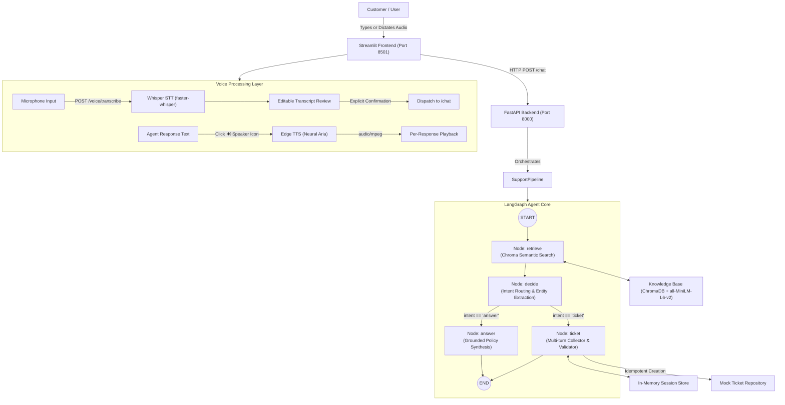

# Customer Support Ticket Agent

A production-grade, multi-modal customer support agent built with **FastAPI**, **Streamlit**, **LangGraph**, **ChromaDB**, **faster-whisper (STT)**, **Edge-TTS (TTS)**, and **Open-Source Instruction LLMs** (supporting both local GPU/CPU execution via Ollama and hosted endpoints via OpenRouter).

---

## 1. Architecture Overview

The system decouples state management, intent classification, grounded retrieval, transactional tool execution, and voice I/O across clean architectural boundaries:



### Component Breakdown
1. **Streamlit UI (`streamlit_app.py`)**: Session-aware chat client providing microphone dictation, editable transcript confirmation, real-time typewriter word streaming, per-response speaker controls (`🔊 Listen`), live source badges (`📄 shipping.md`), ticket confirmation banners, and sidebar health monitoring.
2. **FastAPI Transport (`src/api/server.py`)**: Exposes REST endpoints (`/health`, `/chat`, `/tickets/{ticket_id}`, `/voice/transcribe`, `/voice/synthesize`) with strict Pydantic model validation.
3. **Knowledge Retrieval (`src/rag/retriever.py`)**: Persistent Chroma store indexed with HuggingFace `sentence-transformers/all-MiniLM-L6-v2`. Features content-hash chunk deduplication and cosine relevance score filtering ($\ge 0.25$) to prevent hallucination.
4. **LangGraph Agent Workflow (`src/llm/workflow.py`)**: Multi-step state machine with dedicated intent classification, entity extraction (Name, Email, Issue, Category), multi-turn slot filling, and transactional ticket creation.
5. **Session & Repository Guard (`src/tools/ticket_tool.py`, `src/sessions/store.py`)**: Enforces strict session isolation and guarantees idempotency (repeated queries in the same session return the original ticket rather than generating duplicates).
6. **Voice Pipeline (`src/voice/`)**: Extensible adapter layer implementing `STTService` and `TTSService` interfaces using `faster-whisper` and `edge-tts`.

---

## 2. LLM Provider Flexibility

The agent uses standard OpenAI-compatible completions, allowing reviewers to choose either **Local Inference** or **Hosted Inference**:

### Option A: Local Inference via Ollama (Zero API Key / Fully Local)
Ideal for local evaluation with zero network dependencies or rate limits:
```env
LLM_BASE_URL=http://localhost:11434/v1
LLM_API_KEY=ollama
LLM_MODEL=qwen2.5:3b
```
*(Alternatively `qwen2.5-coder:3b` or `llama3.2:3b`)*

### Option B: Hosted Open-Source Inference via OpenRouter
Ideal for reviewers running on headless or resource-constrained environments:
```env
LLM_BASE_URL=https://openrouter.ai/api/v1
LLM_API_KEY=sk-or-v1-your-openrouter-key
LLM_MODEL=meta-llama/llama-3.1-8b-instruct
```

---

## 3. Voice Component Architecture (Mid-Session Requirement)

### Selected Providers & Rationale

| Component | Selected Implementation | Why Chosen |
| :--- | :--- | :--- |
| **STT (Speech-to-Text)** | **faster-whisper (`tiny.en`)** | Completely local, runs in ~500ms on CPU/GPU, high accuracy on English support queries, bundles PyAV/ffmpeg, requires **zero API keys**, compliant with library restrictions (individual component library, no prohibited all-in-one platforms). |
| **TTS (Text-to-Speech)** | **Microsoft Edge TTS (`en-US-AriaNeural`)** | Generates natural human-quality neural voice in ~600ms, outputs standardized MP3 (`audio/mpeg`), requires **zero API keys**, compliant with library restrictions. |

### Voice Endpoints
* **`POST /voice/transcribe`**: Accepts audio file (`audio/wav`, `audio/mpeg`), returns:
  ```json
  {
    "success": true,
    "transcript": "My payment was charged twice.",
    "processing_time_ms": 557
  }
  ```
  Gracefully handles empty or unintelligible audio with `{"success": false, "error": "No understandable speech was detected"}`.
* **`POST /voice/synthesize`**: Accepts `{"message_id": "msg-1", "text": "..."}`, returns binary audio bytes with `Content-Type: audio/mpeg`.

---

## 4. Setup & Installation

### Prerequisites
* Python 3.11 or newer
* Git

### Windows PowerShell
```powershell
py -3.11 -m venv .venv
.\.venv\Scripts\Activate.ps1
python -m pip install -r requirements.txt
Copy-Item .env.example .env
```

### Linux / macOS
```bash
python3 -m venv .venv
source .venv/bin/activate
python -m pip install -r requirements.txt
cp .env.example .env
```

Configure `.env` with your preferred endpoint (Ollama or OpenRouter).

---

## 5. Running the Application

### Step 1: Start the FastAPI Backend
```bash
uvicorn src.api.server:app --reload --host 127.0.0.1 --port 8000
```
* Interactive API Documentation (Swagger): `http://localhost:8000/docs`
* Readiness Probe: `http://localhost:8000/health`

### Step 2: Start the Streamlit User Interface
In a separate terminal window:
```bash
streamlit run streamlit_app.py --server.address 127.0.0.1 --server.port 8501
```
* Open your browser at: `http://localhost:8501`

---

## 6. Automated Test Suite

A comprehensive test suite with **31 automated tests** covers 100% of required functionality:
* Grounded RAG retrieval & source attribution
* Zero-fabrication behavior for unknown/out-of-domain questions
* Missing-field validation & multi-turn slot filling
* Session isolation across client IDs
* Ticket repository idempotency & duplicate prevention
* Endpoint readiness and 404/422/503 HTTP status mappings
* **Voice STT transcription contracts & empty-audio validation**
* **Voice TTS synthesis contracts & failure recovery**
* **Voice timing telemetry & media type enforcement**
* **Typed-chat regression immunity after voice integration**
* **Correct association between agent responses and audio playback**

To run tests:
```bash
pytest -v
```

---

## 7. Representative Evaluation Queries

| Scenario | Input Query | Expected Agent Behavior |
| :--- | :--- | :--- |
| **Grounded Policy** | *"How long does standard delivery take?"* | Returns `"three to five business days"` with source `shipping.md`. |
| **Reasoning Policy** | *"Can I return an item after 20 days?"* | Deduces that 20 days is within the 30-day window, confirms eligibility, cites `returns.md`. |
| **Unknown Question** | *"What is the recipe for chocolate cake?"* | States clearly that support documentation does not contain the answer. No fabrication. |
| **Voice Dictation** | User speaks: *"My payment was charged twice"* | Whisper transcribes audio $\rightarrow$ user reviews/edits transcript $\rightarrow$ confirms submit $\rightarrow$ calls `POST /chat`. |
| **Voice Playback** | User clicks `🔊 Listen` on agent response | Synthesizes response to MP3 via Edge TTS $\rightarrow$ plays audio under response. Cached for re-clicks. |
| **Turn 1 (Ticket)** | *"My credit card was charged twice for order #1024"* | Classifies intent as `ticket`, extracts category as `payment`, prompts for customer name. |
| **Turn 2 (Ticket)** | *"Sanskar Tolani"* | Stores name, politely requests email address. |
| **Turn 3 (Ticket)** | *"sanskar@example.com"* | Validates email, creates ticket `CST-2026-0001`, displays confirmation. |
| **Ticket Lookup** | `GET /tickets/CST-2026-0001` | Returns complete ticket JSON payload with creation timestamp and `open` status. |
| **Idempotency** | Repeating Turn 3 in the same session | Returns existing ticket ID `CST-2026-0001` without creating a duplicate. |

## Voice troubleshooting

- **First transcription is slow:** the Whisper `tiny.en` model (about 75 MB) is downloaded on first use. The API loads it in the background at startup, so wait a minute after starting, or watch the API terminal. An offline first run shows a clear "model could not be loaded" message in the app instead of a vague error.
- **"Listen to Response" shows a warning:** Edge TTS needs an internet connection. The app shows the real reason; fix the connection and press the button again (audio is generated on demand and cached per response).
- **Transcript box shows an old transcript:** fixed. Each new recording replaces the editable transcript.
- Run the voice tests with `python -m pytest tests/test_voice.py tests/test_voice_adapters.py`.
